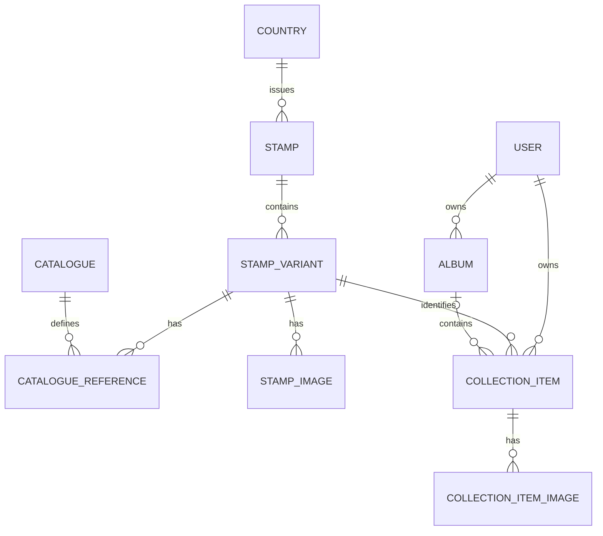

# Database Architecture

## Overview

Stamp Collection Manager v3.0 uses PostgreSQL and Prisma ORM.

The database separates shared stamp catalogue information
from user-owned collection information.

## Design Principles

- Relational database normalisation.
- Multi-user data isolation.
- Referential integrity.
- Reusable catalogue information.
- Support for multiple catalogue systems.
- Optional album allocation.
- Support for future application features.

## Global Catalogue Models

- Country
- Stamp
- StampVariant
- Catalogue
- CatalogueReference
- StampImage

## Personal Collection Models

- User
- Album
- CollectionItem
- CollectionItemImage

## Entity Relationships

## Data Ownership

Catalogue information is shared between users.

Albums, collection items and personal photographs
belong to individual users.

All access to personal records must be authorised
on the server.

An item can only be assigned to an album belonging
to the same user.

## Stamp Variations

A stamp represents a general stamp issue.

A stamp variant represents an identifiable version,
including plate number, colour, perforation or watermark.

Each stamp should have at least one variant.

## Catalogue References

A stamp variant can have multiple catalogue references,
including Stanley Gibbons, Scott, Michel and Yvert.

Catalogue numbers are stored as strings.

## Album Allocation

Album allocation is optional.

A collection item with a null albumId is considered
unallocated.

Deleting an album must not delete the stamps owned
by the user.

## Collection Items

Each collection item references a user and a stamp variant.

It can store condition, quantity, notes and acquisition
information.

Quantity must be greater than zero.

Copies with different conditions or individual details
can be stored as separate collection items.

## Image Management

Shared catalogue images are separate from personal
collection photographs.

The database stores image references and metadata.

Actual image storage will be implemented in a later phase.

## Future Extensions

- Authentication and authorisation
- CSV import and export
- Collection valuations
- Album page designer
- Printable album pages
- Collection sharing

## Implementation Status

Initial architecture designed during Week 6, Day 1.

Prisma models and migrations will be implemented
incrementally during Sprint 06.

