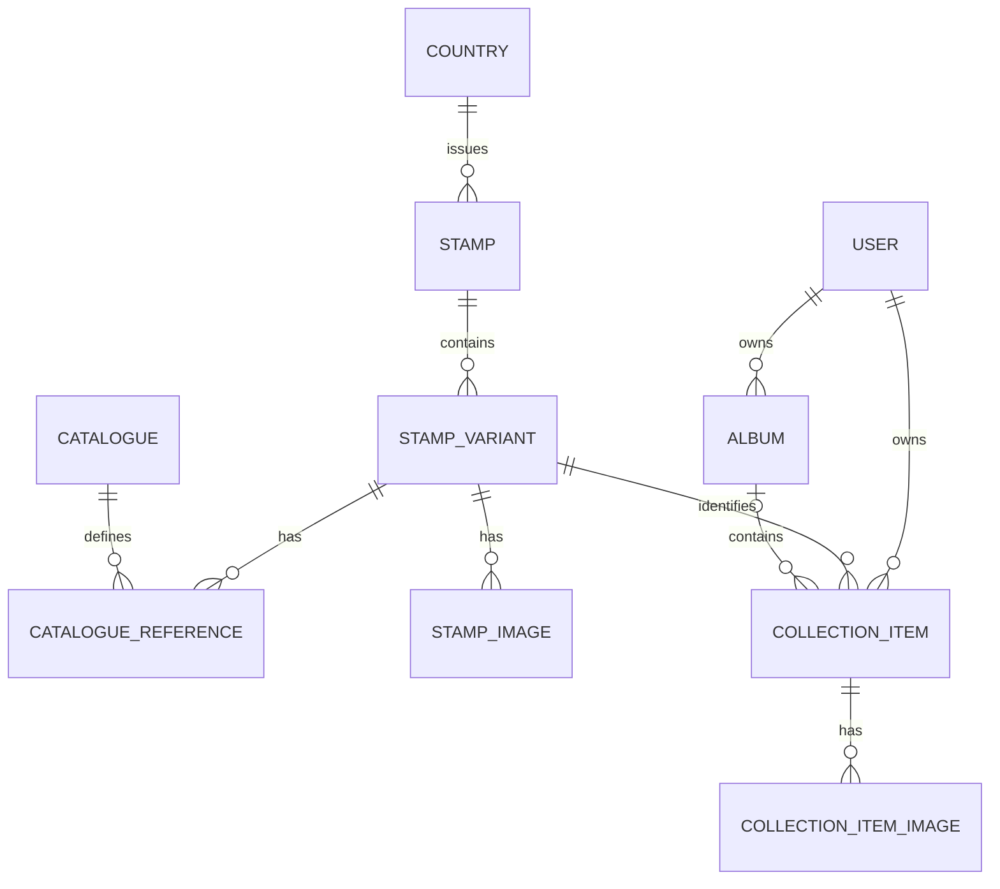

# Database Architecture

## Overview

Stamp Collection Manager v3.0 uses PostgreSQL and Prisma ORM.

The database separates shared stamp catalogue information
from user-owned collection information.

## Design Principles

- Relational database normalisation.
- Multi-user data isolation.
- Referential integrity.
- Reusable catalogue information.
- Support for multiple catalogue systems.
- Optional album allocation.
- Support for future application features.

## Global Catalogue Models

- Country
- Stamp
- StampVariant
- Catalogue
- CatalogueReference
- StampImage

## Personal Collection Models

- User
- Album
- CollectionItem
- CollectionItemImage

## Entity Relationships

## Data Ownership

Catalogue information is shared between users.

Albums, collection items and personal photographs
belong to individual users.

All access to personal records must be authorised
on the server.

An item can only be assigned to an album belonging
to the same user.

## Stamp Variations

A stamp represents a general stamp issue.

A stamp variant represents an identifiable version,
including plate number, colour, perforation or watermark.

Each stamp should have at least one variant.

## Catalogue References

A stamp variant can have multiple catalogue references,
including Stanley Gibbons, Scott, Michel and Yvert.

Catalogue numbers are stored as strings.

## Album Allocation

Album allocation is optional.

A collection item with a null albumId is considered
unallocated.

Deleting an album must not delete the stamps owned
by the user.

## Collection Items

Each collection item references a user and a stamp variant.

It can store condition, quantity, notes and acquisition
information.

Quantity must be greater than zero.

Copies with different conditions or individual details
can be stored as separate collection items.

## Image Management

Shared catalogue images are separate from personal
collection photographs.

The database stores image references and metadata.

Actual image storage will be implemented in a later phase.

## Future Extensions

- Authentication and authorisation
- CSV import and export
- Collection valuations
- Album page designer
- Printable album pages
- Collection sharing

## Implementation Status

Initial architecture designed during Week 6, Day 1.

Prisma models and migrations will be implemented
incrementally during Sprint 06.

Stamp Collection Manager — Database Architecture v3.0

Overview

The Stamp Collection Manager uses PostgreSQL and Prisma to provide a personal-first, multi-user-ready philatelic collection management system.

The database separates shared catalogue information from individual physical stamp ownership and future printable album layouts.

Technology

PostgreSQL 16

Prisma ORM 7

Next.js App Router

TypeScript

Docker Compose

Relational database constraints

Database structure

The Week 6 database architecture contains 26 models and six enums, organised into six functional domains:

Domain

Models

Identity and geography

2

International catalogue

4

Reusable philatelic attributes

9

Dynamic stamp variations

5

Historical catalogue valuations

2

Personal collections and images

4

Total

26

Shared catalogue

The shared catalogue describes stamps independently of whether a collector owns them.

A stamp includes its issuing country, issue date, denomination, physical dimensions, catalogue references and optional philatelic attributes.

Multiple international catalogues are supported, including Stanley Gibbons, Scott, Michel and Yvert & Tellier.

Catalogue numbers are stored as strings. Suffixes are preserved and are not automatically interpreted as variations.

Reusable attributes

Colours, watermarks, perforations, stamp classifications, themes and series are represented by reusable database records.

Colours and themes support many-to-many relationships. Watermark designs may be associated with issuing countries.

Actual stamp dimensions are independent of perforation measurements.

Dynamic stamp variations

Variations are optional and belong to a shared catalogue stamp.

VariationType, VariationValue and VariantAttribute support expandable stamp characteristics without requiring additional database columns.

Dedicated relationships are used for colours, watermarks and perforations to avoid duplication.

Variations may override selected characteristics of their parent stamp.

Historical catalogue valuations

Catalogue valuations are linked to a catalogue reference, publication edition, stamp status and currency.

Valuations can apply to a general catalogue entry or a specific stamp variation.

Historical editions are retained instead of replacing published values with newer prices.

Catalogue valuations remain independent of personal purchase prices and market estimates.

Personal collections

Each CollectionItem represents one physical stamp belonging to a collector.

Collection quantities are calculated by counting ownership records.

A physical stamp may be allocated to one personal album or remain unallocated.

Compound foreign keys prevent cross-user album assignments and incorrect stamp variation references.

Stamp status and physical grade are stored independently.

An unknown purchase price is represented by NULL. A zero purchase price represents a free acquisition.

Image management

CatalogueImage stores shared reference image metadata.

CollectionImage stores metadata for photographs of individual physical stamps.

The actual image files will be managed by a separate storage service. Storage keys provide a provider-independent reference to those files.

Private image access, file validation and storage lifecycle management will be implemented in a later development phase.

Deletion policies

Album deletion must preserve owned stamps. The application will unallocate stamps before deleting their album.

Deleting collection items cascades to their personal image metadata.

Deleting shared catalogue records that are referenced by owned stamps or valuations is restricted.

Database integrity

The implementation uses primary keys, foreign keys, compound unique constraints, CHECK constraints and partial unique indexes.

Financial amounts use PostgreSQL Decimal fields.

Custom SQL migrations enforce constraints that are not represented directly in the current Prisma schema.

Multi-user security

Database relationships enforce ownership consistency but do not independently provide authentication or complete data isolation.

Authentication, server-side authorisation, user-scoped queries and protected image access are required before production deployment.

Future album designer

Printable album layouts will reference shared catalogue entries independently of physical ownership.

Future functionality will include page sizes, automatic placeholder generation, individual placeholder dimensions, manual positioning and printable output.

Outstanding architecture improvements

Case-insensitive uniqueness for reusable definitions.

Duplicate stamp variation detection.

Consistency between issuing countries, watermarks and series.

Validation of inherited variation attributes.

Detailed partial perforation specifications.

Catalogue-specific valuation status mapping.

Authentication and server-side authorisation.

Image storage and lifecycle management.

Automated database integration tests.

Review of acquisition modelling as collection requirements evolve.

Week 6 milestone

The initial relational database implementation provides the foundation for catalogue management, historical valuations, personal collections and albums.

The Week 24 MVP and Week 36 release milestones remain unchanged.