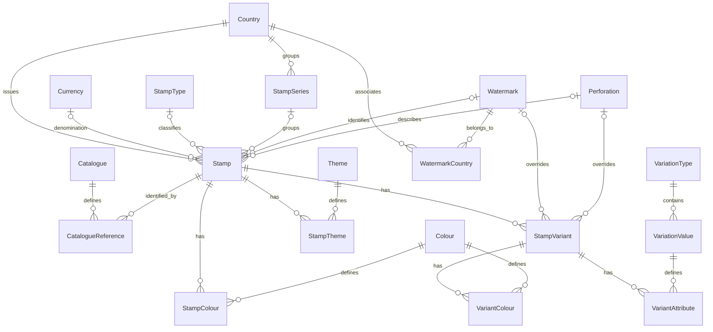
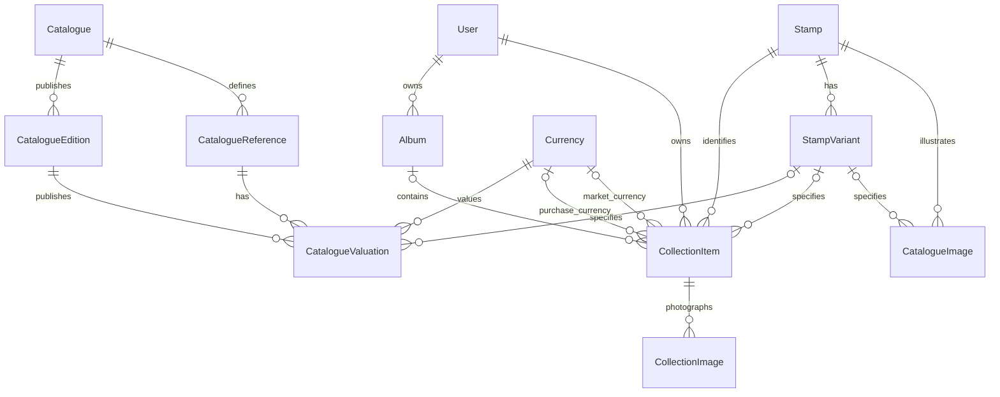

# Stamp Collection Manager — Database ERD

## Overview

This document describes the relational database architecture
implemented during Week 6 of the development roadmap.

The database contains 26 models organised into shared catalogue
information, reusable attributes, dynamic variations, historical
valuations and personal collections.

## 1. Shared Catalogue and Philatelic Attributes

## 2. Catalogue Valuations and Personal Ownership

## 3. Relationship Notation

- `||` — Exactly one.
- `o|` — Zero or one.
- `o{` — Zero or many.
- `|{` — One or many.

## 4. Source of Truth

These diagrams represent the logical database relationships.

The authoritative database definition is located in:

`prisma/schema.prisma`

Custom database constraints are maintained in:

`prisma/migrations/`

## 5. Architecture Version

- Project: Stamp Collection Manager v3.0
- Sprint: Week 06
- Database: PostgreSQL 16
- ORM: Prisma 7
- Models: 26
- Enums: 6
