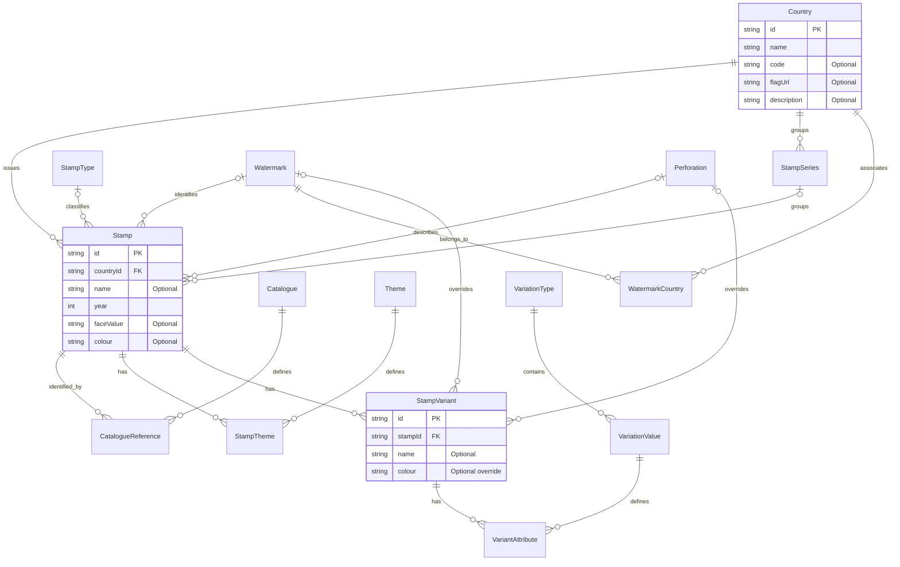
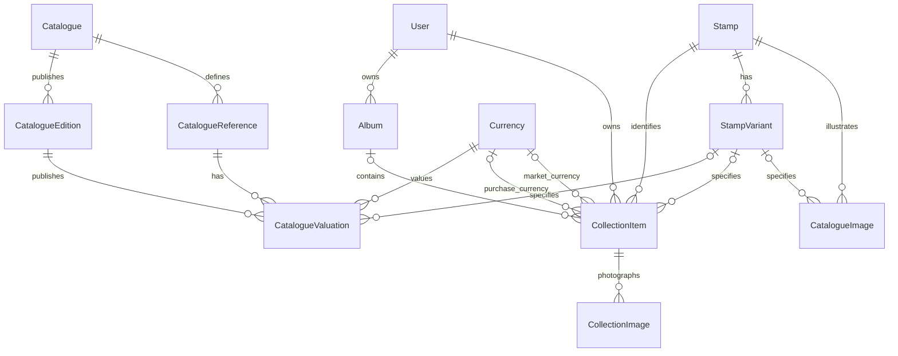

# Stamp Collection Manager — Database ERD

## Overview

This document describes the relational database architecture implemented in Week 6 and refined during Sprint 07.5. The database contains 23 models organised into shared catalogue information, reusable attributes, dynamic variations, historical valuations and personal collections.

Sprint 07.5 added optional country metadata, replaced normalised colour relationships with optional text properties, and separated printed stamp denominations from financial currencies. The diagrams display logical relationships and selected attributes, not every column or constraint.

## 1. Shared Catalogue and Philatelic Attributes

`StampVariant.colour` is an optional override. When missing or blank, the application inherits the parent stamp colour. Inherited values are not stored twice.

## 2. Catalogue Valuations and Personal Ownership

Currency remains connected to catalogue valuations, purchase currency and market valuation currency. Printed `Stamp.faceValue` is independent of Currency. Compound keys and custom PostgreSQL constraints enforce additional consistency rules not depicted in these logical diagrams.

## 3. Relationship Notation

- `||` — Exactly one.
- `o|` — Zero or one.
- `o{` — Zero or many.
- `|{` — One or many.

## 4. Source of Truth

The authoritative database definition is [`prisma/schema.prisma`](../prisma/schema.prisma). Custom database constraints are maintained in [`prisma/migrations/`](../prisma/migrations/).

See [Database Architecture](./database-architecture.md) and [Sprint 07.5 Migration Review](./sprint-07-5-migration-review.md) for design decisions and migration validation.

## 5. Architecture Version

- Project: Stamp Collection Manager v3.0
- Sprint: 07.5 — Database Refinement
- Database: PostgreSQL 16
- ORM: Prisma 7
- Models: 23
- Enums: 6
- Migrations: 9
